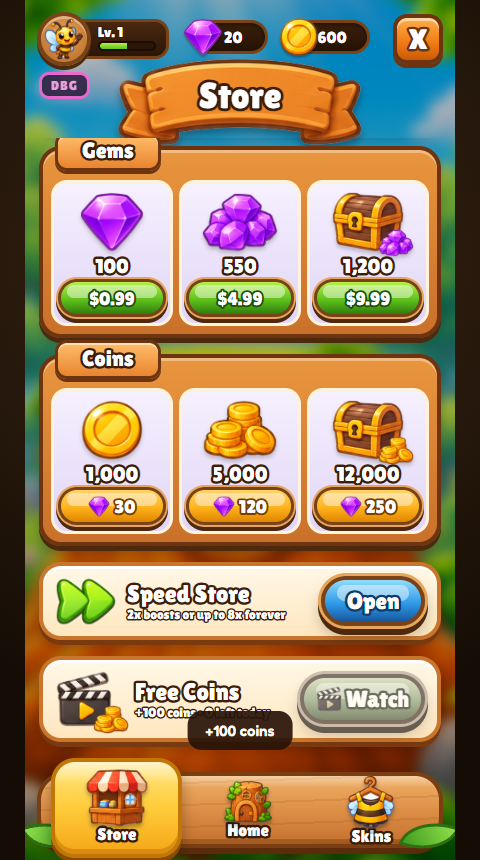

# Bugs found by these skills

Real bugs that `test-game-full`, `full-playthrough` and `root-cause-analysis` found in my game [Pixel Swarm](https://github.com/heloisatorres1/pixel-swarm) (v1.0.0, commit `db96df5`). Every one was reproduced at least twice from a clean state, and each has a video, screenshots, before/after save data and the line of code involved.

| ID | Severity | Bug | Reproduced | Video | Status |
|---|---|---|---|---|---|
| [BUG-001](#bug-001-level-complete-closes-on-a-tap-outside-it-the-reward-is-lost) | Major | Level Complete closes on a tap outside it: the reward is lost | 12/12 | [tap](examples/pixel-swarm-full/test-progression/evidence/PR-W2-run1-tap.webm) · [Escape](examples/pixel-swarm-full/test-progression/evidence/PR-W2-run3-escape.webm) | Open |
| [BUG-002](#bug-002-settings-and-close-pushed-off-screen-on-360-px-phones) | Major | Settings and Close pushed off screen on 360 px phones | 3/3 (+30 measured cases) | [store session](examples/pixel-swarm-full/test-ui/evidence/UI-21-gear-pushed-off.webm) | Open |
| [BUG-003](#bug-003-the-store-sells-no-ads-again-to-players-who-own-it) | Major | The store sells No Ads again to players who own it | 4/4 | [purchase](examples/pixel-swarm-full/test-store/evidence/ST-08-run1.webm) | Open |
| [BUG-008](#bug-008-player-xp-never-grows-the-player-stays-level-1-forever) | Major | Player XP never grows: the player stays level 1 forever (found by the 102-level playthrough) | 2/2 | [after 102 wins](examples/pixel-swarm-playthrough/evidence/BUG-008-after-102-wins.webm) | Open |
| [BUG-004](#bug-004-add-slot-from-out-of-slots-has-no-limit) | Minor | Add Slot from Out of Slots has no limit | 5/5 | [6 x Add Slot](examples/pixel-swarm-full/test-puzzles/evidence/PZ-35-run1-add-slot.webm) | Open |
| [BUG-009](#bug-009-free-coins-pays-again-when-enter-or-space-is-pressed-during-the-ad) | Minor | Free Coins pays again when Enter or Space is pressed during the ad (found by `root-cause-analysis`) | 2/2 | [screenshot](examples/root-cause-analysis/4-free-coins-extra-rewards/evidence/run1-C-keyboard-repeat.png) | Open |

All bugs are **open**: they are reported, not fixed in the game yet. Three smaller ones (BUG-005 to BUG-007) are in the [examples index](examples/README.md#bugs-found).

The full test pass (80 checks, text review, queries and everything that passed) is in the [merged report](examples/pixel-swarm-full/report.md). The playthrough of all 102 levels is in its [completion report](examples/pixel-swarm-playthrough/completion-report.html) and [inventory](examples/pixel-swarm-playthrough/inventory.md). Videos are WebM: GitHub shows them as files, so open "View raw" or download to play them. The HTML report (`report.html`) plays them inline.

---

## BUG-001: Level Complete closes on a tap outside it, the reward is lost

**Major** · Reproduced 4/4 in each of three sessions (12/12) · Web, 390x844 touch

**Steps**
1. Win any level (here Flowers Easy level 1, which shows "+30").
2. Tap the dimmed area outside the popup card, or press Escape.

**Expected:** the popup stays until Continue or Claim x2 is chosen (like the Out of Slots popup, which is locked).
**Actual:** the popup closes, the coins stay at 100, and the board is empty with no Continue button. The win is saved, so the player can only leave through Pause, and the reward is lost.

**Cause:** `#popup-complete` lacks `data-locked` (`index.html:423`), so the generic outside-tap handler (`js/app.js:3028`) and the Escape handler close it without calling `finishWin()`. `#popup-fail` has the attribute.
**Fix:** add `data-locked` to `#popup-complete`.

Evidence: [video, tap](examples/pixel-swarm-full/test-progression/evidence/PR-W2-run1-tap.webm) · [video, Escape](examples/pixel-swarm-full/test-progression/evidence/PR-W2-run3-escape.webm) · [frames](examples/pixel-swarm-full/test-progression/evidence/PR-W2-run1-frames) · [save before/after](examples/pixel-swarm-full/test-progression/evidence/PR-W2-run1-state.json) · [test script](examples/pixel-swarm-full/scripts/progression.mjs)

---

## BUG-002: Settings and Close pushed off screen on 360 px phones

**Major** · 2 measured runs (15 balance cases each) + 1 recorded session · Web, 360 / 390 / 412 px touch

**Steps**
1. Open the game on a 360 px wide phone (one of the most common Android widths).
2. Look at the top-right corner: the Settings gear is already half cut at 20 gems / 100 coins.
3. Buy gems and coins in the store: the store's Close X leaves the screen, then the Settings gear.

**Expected:** level, gems, coins and the gear (menu) / X (store) always fit on screen.
**Actual:** at 360 px the gear shows 29 of 42 px at the start and 0 px with 4-digit balances. 390 px is cut from 9,999. 412 px is nearly fine.

| Width | 100 coins | 9,999 | 12.3K | 98.8K / 123.5K | 1.2M |
|---|---|---|---|---|---|
| 360 px, gear visible | 29/42 px | **0** | 6 | **0** | 14 |
| 390 px, gear visible | 47/47 | 28/42 | 36 | 24 | 42 |
| 412 px, gear visible | 50/50 | 42/42 | 46 | 42 | 50 |

**Cause (hypothesis):** the currency pills have fixed minimum widths and the row never shrinks. Numbers below 10,000 are shown in full (`formatNumber` abbreviates only from 10,000), so they are the widest.
**Fix:** let the pills shrink, abbreviate from 1,000, and keep the gear / X outside the flexible area.

Evidence: [video](examples/pixel-swarm-full/test-ui/evidence/UI-21-gear-pushed-off.webm) · [step measurements](examples/pixel-swarm-full/test-ui/evidence/UI-21-state.json) · [run 1 table](examples/pixel-swarm-full/test-ui/evidence/UI-20-run1-top-bar.json) · [run 2 table](examples/pixel-swarm-full/test-ui/evidence/UI-20-run2-top-bar.json) · [test script](examples/pixel-swarm-full/scripts/ui.mjs)

---

## BUG-003: The store sells No Ads again to players who own it

**Major** · Reproduced 4/4 · Web, 390x844 touch

**Steps**
1. Own No Ads (bought alone for $2.99, or in an earlier offer).
2. Open the Store and tap $4.99 on the Special Offer.

**Expected:** the offer is hidden for No Ads owners (the popup version already is), or shown without No Ads at a new price.
**Actual:** the card still lists "1,200 gems · 10,000 coins · No Ads" for $4.99 and can be bought, and the toast grants "No Ads" again. With real payments this charges for something the player already owns, which means refund requests and a store-policy risk.

**Cause:** `renderStore()` always builds the offer card (`js/app.js:313`), while the offer popup checks `state.noAds` (`js/app.js:698`).
**Fix:** apply the same `state.noAds` check to the store card.

Evidence: [video](examples/pixel-swarm-full/test-store/evidence/ST-08-run1.webm) · [save before/after, run 1](examples/pixel-swarm-full/test-store/evidence/ST-08-run1-state.json) · [run 2](examples/pixel-swarm-full/test-store/evidence/ST-08-run2-state.json) · [test script](examples/pixel-swarm-full/scripts/store.mjs)

---

## BUG-004: Add Slot from Out of Slots has no limit

**Minor** · Reproduced 5/5 · Web, 390x844 touch (the fails were triggered with the debug "Lose level"; Add Slot and its ad are the real flow)

**Steps**
1. Start a level (4 slots).
2. Run out of slots and choose "Add Slot" on the Out of Slots popup (watch the 3 s ad).
3. Repeat 6 times.

**Expected:** the same limit as the Add Slot booster, which stops at 7 ("Maximum slots reached").
**Actual:** 4 → 5 → 6 → 7 → 8 → 9 → 10 slots. At 10 they shrink to thin pills across the whole width, and the first slot's block is wider than its neighbours.

**Cause:** the fail-popup handler pushes a slot with no limit (`js/app.js:2681`), while the booster checks `slots.length >= 7` (`js/app.js:2122`).
**Fix:** use the same check in `fail-addslot`, and hide the button on the popup at 7 slots.

Evidence: [video](examples/pixel-swarm-full/test-puzzles/evidence/PZ-35-run1-add-slot.webm) · [slot counts, run 1](examples/pixel-swarm-full/test-puzzles/evidence/PZ-35-run1-state.json) · [run 2](examples/pixel-swarm-full/test-puzzles/evidence/PZ-35-run2-state.json) · [test script](examples/pixel-swarm-full/scripts/puzzles.mjs)

---

## BUG-008: Player XP never grows, the player stays level 1 forever

**Major** · Found by `full-playthrough` · Reproduced 2/2 (after all 102 levels, and on a fresh player after 1, 2 and 3 wins)

**Steps**
1. Win levels (any number; the playthrough won all 102).
2. Open the Profile (tap the avatar), then Skins > Firefly.

**Expected:** wins give XP, the player levels up (the Profile promises "Next reward: 50" coins), and level-gated content opens: the Firefly bug at level 5, two avatars at levels 10 and 20.
**Actual:** XP stays 1/2 and the player stays level 1. The Firefly and all 7 of its looks say "Unlocks at player level 5", and two avatars stay locked. That content can only be reached through the debug menu.

**Cause:** nothing adds XP. `track('level')` counts wins but never touches `state.xp`, and the only code that raises `playerLevel` is the debug `levelup` / `xp` commands (`js/app.js:2611`). `LEVEL_UP_REWARD = 50` (`js/app.js:570`) is shown but never paid.
**Fix:** add XP per win in `track('level')`, and level up when `xp >= xpToNext` (grow `xpToNext`, pay the reward, show a toast).

Evidence: [video](examples/pixel-swarm-playthrough/evidence/BUG-008-after-102-wins.webm) · [save after 102 wins and after 1-3 wins](examples/pixel-swarm-playthrough/evidence/BUG-008-state.json) · [completion report](examples/pixel-swarm-playthrough/completion-report.html) · [test script](examples/pixel-swarm-playthrough/scripts/xp-check.mjs)

---

## BUG-009: Free Coins pays again when Enter or Space is pressed during the ad

**Minor** · Found by `root-cause-analysis`, starting from a vague player report ("I got Free Coins 6 times today") · Reproduced 2/2 · Web, Edge, keyboard

**Steps**
1. Open the Store with 0 Free Coins used today.
2. Click **Watch** on Free Coins.
3. While the 3 s ad plays, press Enter (or Space) 5 times.

**Expected:** one ad pays once; at most 5 rewards a day.
**Actual:** 6 rewards (600 coins) from one ad, and the Store says "0 left today". Slow mouse clicks stop at 5 and a mouse double-click pays once, so mouse testing never shows it.

**Cause:** the daily limit is checked when Watch is pressed (`js/app.js:442`), but the use is only counted when the ad ends, 3 s later. `showAd` (`js/app.js:418`) never checks whether an ad is already playing. The ad overlay blocks the mouse, but keyboard focus stays on the Watch button.
**Fix:** in `showAd`, return at once if the ad overlay is already showing (1 line, proven: 6 rewards before, 1 after). The same guard protects the other rewarded ads (x2 win reward, extra slot), which were read in the code but not run.

Evidence: [root cause report](examples/root-cause-analysis/4-free-coins-extra-rewards/rca.md) · [run 1](examples/root-cause-analysis/4-free-coins-extra-rewards/repro/run1.txt) · [run 2](examples/root-cause-analysis/4-free-coins-extra-rewards/repro/run2.txt) · [fix](examples/root-cause-analysis/4-free-coins-extra-rewards/proof/fix.diff) · [regression test](examples/root-cause-analysis/4-free-coins-extra-rewards/proof/regression-test.mjs)
