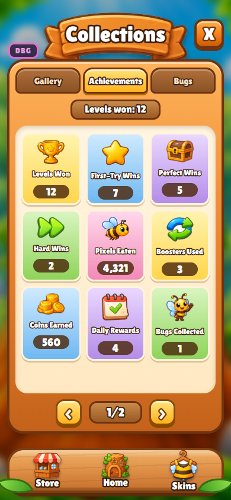
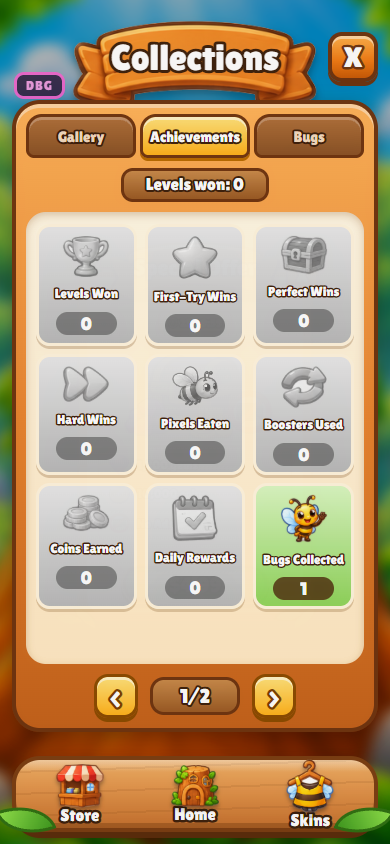
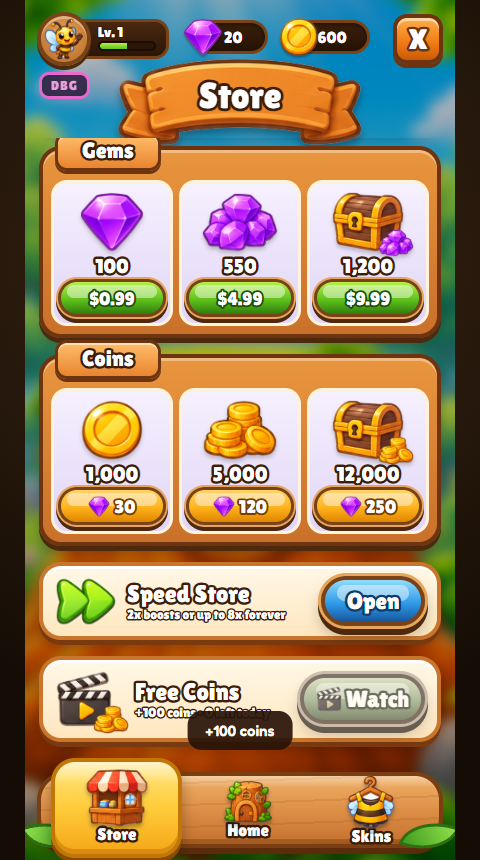
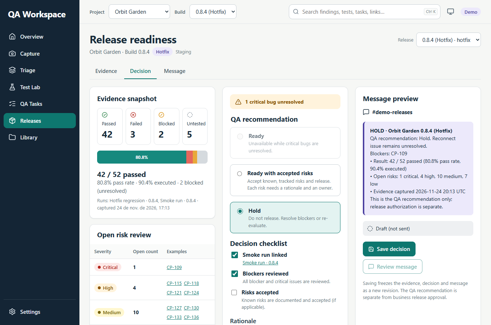

# What `root-cause-analysis` gives you: 5 real results

You give the skill one bug report. It gives back the line of code that causes the bug, a fix that has been **proven** in a copy of the project, everything else the same cause breaks, and a test that catches the bug next time.

Below are the 5 results from the [benchmark](README.md), one per bug, as a developer would read them. Each full report (`rca.md`) has the proof runs, screenshots and the test output.

| | Bug report | Root cause | Fix size | Confidence |
|---|---|---|---|---|
| [1](#1-achievements-go-back-to-0-after-a-refresh) | Achievements go back to 0 after a refresh | Merge order reversed in `js/app.js:97` | 1 line | Confirmed |
| [2](#2-daily-reward-check-marks-disappear-after-claiming) | Daily check marks disappear after claiming | Streak check ignores "claimed today" in `js/app.js:458` | 1 line | Confirmed |
| [3](#3-player-level-never-goes-up) | Player level never goes up | No code awards XP on a win, near `js/app.js:930` | 8 lines | Confirmed |
| [4](#4-free-coins-pays-more-than-5-times-a-day) | "I got Free Coins 6 times today" | No guard against a second ad in `js/app.js:418` | 1 line | Confirmed (mechanism) / Likely (what the player did) |
| [5](#5-a-critical-in-progress-bug-is-missing-from-the-release-blockers) | Critical bug missing from release blockers | "In progress" missing from a status list in `src/domain/findings.ts:29` | 1 line | Confirmed |

---

## 1. Achievements go back to 0 after a refresh

Pixel Swarm · [full report](1-stats-reset-after-reload/rca.md) · bug planted for the test

| Before the refresh | After the refresh |
|---|---|
|  |  |

**Root cause** (`js/app.js:97`): loading the game combines the saved stats with the starting stats (all zeros). The last one wins, and the zeros are last.

```js
// wrong
s.stats = Object.assign({}, s.stats, DEFAULT_STATE.stats);
// fix
s.stats = Object.assign({}, DEFAULT_STATE.stats, s.stats);
```

**Also found:**
- The game saves the zeros right after loading, so players lose their stats **for good**. The fix stops new losses but cannot restore old ones.
- Boosters that unlock with levels won lock again. This was checked by running the game.

**Regression test:** with the bug, FAIL (Levels Won 12 before the refresh, 0 after). With the fix, PASS.

---

## 2. Daily reward check marks disappear after claiming

Pixel Swarm · [full report](2-daily-check-marks-vanish/rca.md) · bug planted for the test

**Root cause** (`js/app.js:458`): the streak only counts as alive if the last claim was **yesterday**. Right after a claim, the last claim is **today**, so the screen shows 0 check marks.

```js
// wrong
const kept = d.last === yesterday();
// fix
const kept = claimedToday || d.last === yesterday();
```

**Also found:**
- In the middle of a streak, the check marks of earlier days disappear too (3 become 0).
- The reward itself is paid correctly and the saved streak is right, so no player data needs repair.

**Regression test:** with the bug, FAIL. With the fix, PASS, also on day 4 and day 7 of a streak.

---

## 3. Player level never goes up

Pixel Swarm · [full report](3-player-xp-never-grows/rca.md) · **real bug** ([BUG-008](../../FOUND-BUGS.md#bug-008-player-xp-never-grows-the-player-stays-level-1-forever))

**Root cause:** missing code. Winning a level counts the win but never gives XP. The skill searched every line that changes XP or the player level. Only the debug menu does.

```js
// fix, in the win code (js/app.js:930)
state.stats.levels += 1;
addXp(1);   // new: each win gives 1 XP

// new helper
function addXp(n) {
  state.xp += n;
  while (state.xp >= state.xpToNext) {
    state.xp -= state.xpToNext; state.playerLevel += 1;
    state.coins += LEVEL_UP_REWARD; state.stats.coinsEarned += LEVEL_UP_REWARD;
  }
}
```

**Also found:**
- The level-up reward shown on the Profile ("Next reward: 50") is never paid.
- Avatars and the Firefly skin, which unlock with the player level, stay locked.

**Note:** "1 XP per win" is only a suggestion. The amount is a design decision.

**Regression test:** with the bug, FAIL (10 wins, still level 1). With the fix, PASS.

---

## 4. Free Coins pays more than 5 times a day

Pixel Swarm · [full report](4-free-coins-extra-rewards/rca.md) · **new real bug** found by this run ([BUG-009](../../FOUND-BUGS.md#bug-009-free-coins-pays-again-when-enter-or-space-is-pressed-during-the-ad))

The report was vague: "I got Free Coins 6 times today." The run tried every way a player could press the button:
- **Slow mouse clicks:** stops at 5. Correct.
- **Mouse double-click:** pays once. Correct.
- **Click Watch, then press Enter while the ad plays:** **pays 6 times, 600 coins.** Happened 2 of 2 times.



**Root cause** (`js/app.js:418`): the 5-per-day limit is checked when you press Watch, but a use is only counted when the ad ends, 3 seconds later. The ad covers the screen for the mouse, but the keyboard can still press the button. Each press starts another ad.

```js
function showAd(onReward) {
  const el = $('ad-overlay'), ad = nextHouseAd();
  if (!el.hidden) return;   // fix: an ad is already playing, ignore this press
```

**Honest confidence:** the mechanism is **Confirmed**. That this is what the player did is only **Likely**, because the report does not say whether they used a keyboard. The report asks the player.

**Also found:** the other ad rewards (x2 win reward, extra slot) use the same code and likely have the same hole. This was read in the code but not run. The one-line fix covers them too.

**Regression test:** with the bug, FAIL (paid 6 times). With the fix, PASS (5 ads, 5 payments, 500 coins).

---

## 5. A critical in-progress bug is missing from the release blockers

QA Workspace (React + TypeScript) · [full report](5-in-progress-bug-not-a-blocker/rca.md) · bug planted for the test



**Root cause** (`src/domain/findings.ts:29`): the list of statuses that count as "not fixed yet" has only "open". A critical bug someone is working on ("in progress") drops off the blocker list.

```ts
// wrong
const OPEN_STATUSES: FindingStatus[] = ['open'];
// fix
const OPEN_STATUSES: FindingStatus[] = ['open', 'in_progress'];
```

**Also found:**
- The same mistake hides the bug from the Overview counts and from the Triage page's default view, and can let a release be marked "Ready" while a critical bug is still being worked on.
- **2 of the project's own unit tests were already failing** because of it. Running the tests before each change would have caught it.
- Release decisions saved while the bug existed keep the wrong blocker list.

**Regression test:** with the bug, FAIL. With the fix, PASS, and the 2 old failing tests pass again.
